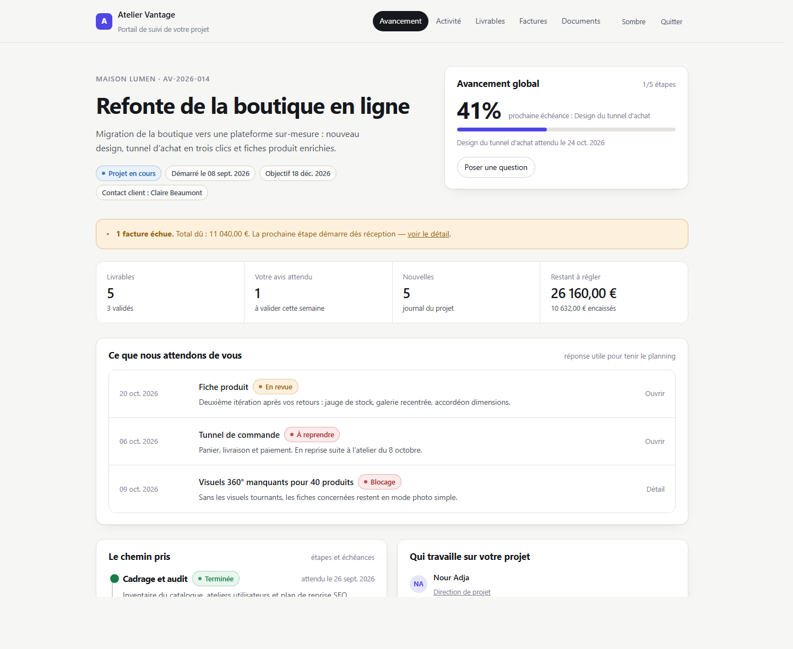
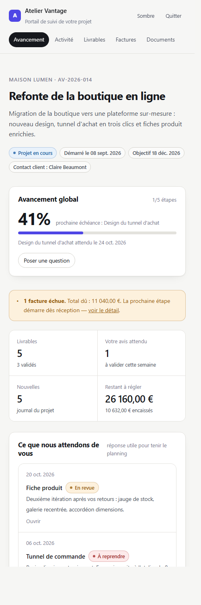
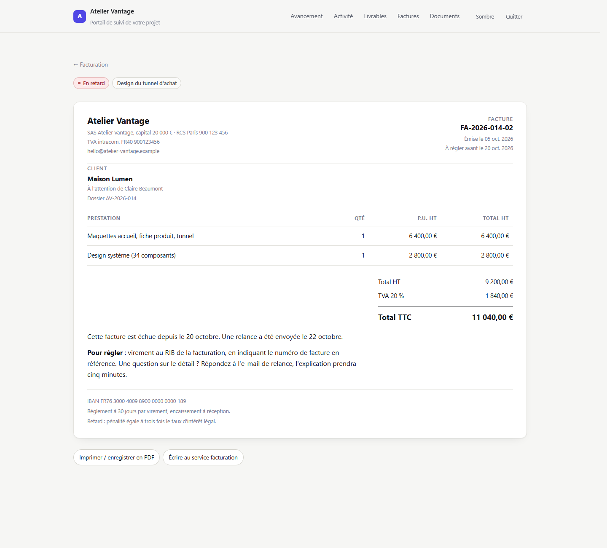
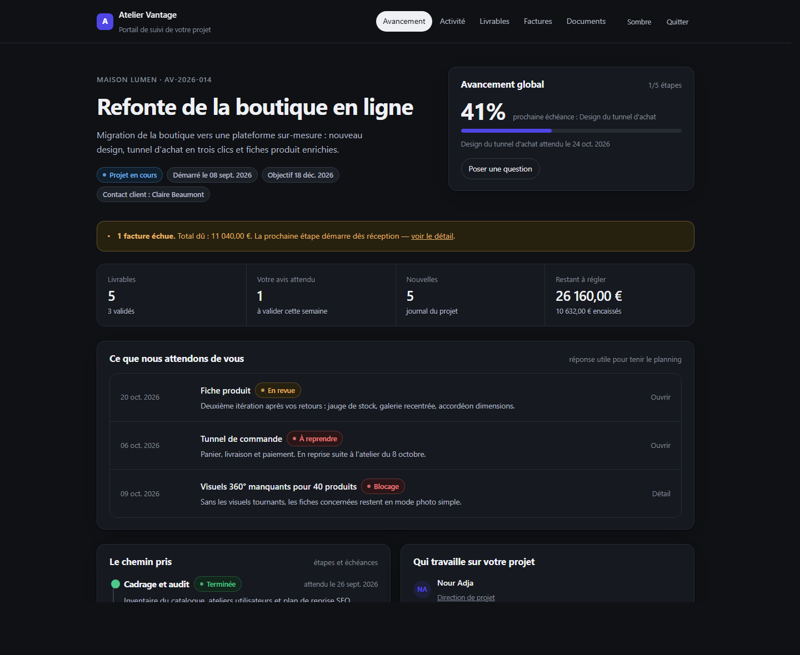

# Portail client — 100 % Git, zéro base de données

**Un tableau de bord minimaliste pour freelances et petites agences.** Vous tenez à jour des fichiers
Markdown et un `project.yaml` dans un dépôt Git : votre client voit l'avancement, ses livrables et ses
factures dans une interface propre, protégée par un mot de passe. Pas de compte à créer, pas de base de
données, pas d'abonnement.

> **English.** A minimalist client portal for freelancers and small agencies: everything lives in a Git
> repository as Markdown and YAML. Push a commit, the client-facing dashboard updates on the next deploy.
> Password protected, no database, deploys to Vercel or Netlify in one click.



| Vue mobile | Facture imprimable | Thème sombre |
| --- | --- | --- |
|  |  |  |

## Pourquoi ce projet existe

Notion est souvent trop lourd pour un client non technique, et les outils de gestion de projet lui
demandent un compte qu'il n'ouvrira jamais. Un portail orienté « fichiers texte + Git » règle trois
problèmes à la fois :

- **Le client ne voit que ce qui le concerne** : une page d'avancement, des livrables, des factures.
- **Vous ne quittez jamais votre éditeur** : mettre à jour le portail = `git commit && git push`.
- **Rien à sauvegarder, rien à migrer** : l'historique complet du projet est dans Git, consultable dans
  dix ans.

## Ce que fait le portail

| Écran | Contenu |
| --- | --- |
| `/` Tableau de bord | Avancement global, prochaine échéance, ce qui attend le client, factures échues, équipe |
| `/activite` Journal | Publications datées (avancement, décision, blocage, livraison), une page par entrée |
| `/livrables` Livrables | Statut par document : brouillon, en revue, validé, à reprendre + liens de fichiers |
| `/factures` Factures | Détail imprimable avec lignes, HT / TVA / TTC, détection automatique des retards |
| `/documents` Mode d'emploi | Les règles du projet écrites une fois : valider, préparer les contenus, payer |
| `/login` Accès | Mot de passe unique, cookie signé, aucune donnée exposée avant connexion |

Côté fonctionnalités transverses : thème clair/sombre, mise en page mobile, feuille de style d'impression
pour les factures, et un bouton « Actualiser » qui déclenche le rebuild de l'hébergeur quand un commit vient
d'être poussé.

## Démarrage en 10 minutes

### 1. Créer le dépôt du client

Utilisez ce dépôt comme modèle (**Use this template** → *Create a new repository*), puis :

```bash
git clone https://github.com/VOTRE-COMPTE/portail-maison-lumen.git
cd portail-maison-lumen
npm install
cp .env.example .env.local
```

Générez un mot de passe et une clé aléatoire, puis renseignez-les dans `.env.local` :

```bash
openssl rand -base64 12   # PORTAL_PASSWORD
openssl rand -hex 32      # PORTAL_SECRET
```

### 2. Décrire le projet

Tout part de `content/`. Ouvrez `content/project.yaml` et remplacez l'exemple :

```yaml
branding:
  studio: "Atelier Vantage"
  tagline: "Portail de suivi de votre projet"
  accent: "#4f46e5"

project:
  title: "Refonte de la boutique en ligne"
  client: "Maison Lumen"
  reference: "AV-2026-014"
  summary: "Migration vers une plateforme sur-mesure."
  started_on: 2026-09-08
  target_on: 2026-12-18

status: active        # active | delivery | paused | done

contact:
  email: "hello@atelier-vantage.example"

team:
  - name: "Nour Adja"
    role: "Direction de projet"
    email: "nour@atelier-vantage.example"

links:
  - label: "Écrire à l'équipe"
    url: "mailto:hello@atelier-vantage.example"
    kind: email

support:
  hours: "Du lundi au vendredi, 9h - 18h (CET)"

billing:
  legal: "SAS Atelier Vantage · RCS Paris 900 123 456"
  vat: "TVA intracom. FR40 900123456"
  iban: "FR76 3000 4009 8900 0000 0000 189"
  terms: "Règlement à 30 jours par virement."
```

Les étapes du planning vivent dans `content/milestones.yaml` :

```yaml
milestones:
  - id: design
    title: "Design du tunnel d'achat"
    status: active          # done | active | planned | blocked
    progress: 75
    start: 2026-09-29
    due: 2026-10-24
```

### 3. Publier une mise à jour

Une nouvelle = un fichier Markdown avec un bloc de métadatas :

```markdown
---
date: 2026-10-21
title: "Le tunnel d'achat passe de 4 à 2 étapes"
kind: progress            # progress | decision | blocker | release | note
milestone: integration
summary: "Le client peut déjà commander sans compte."
---

Le panier et l'étape livraison sont fusionnés : un seul écran, trois champs en moins.
```

```bash
git add content && git commit -m "nouvelle : tunnel 2 étapes" && git push
```

C'est tout : le redéploiement régénère le portail.

```bash
npm run dev      # http://localhost:3000 avec .env.local
npm run build    # génère generated/content.json puis compile le site
```

## Arborescence du contenu

```
content/
├── project.yaml          marque, projet, équipe, mentions de facturation   (obligatoire)
├── milestones.yaml       étapes, statut, pourcentage, échéances
├── updates/UNE-NOUVELLE.md
├── deliverables/UN-LIVRABLE.md
├── invoices/UNE-FACTURE.md
└── docs/UN-GUIDE.md
```

Les noms de fichiers deviennent les URL : `content/updates/design-system-v2.md` se lit sur
`/activite/design-system-v2`. Utilisez des minuscules, des chiffres et des tirets.

### Format d'une facture

Les totaux sont calculés, jamais saisis à la main : `total HT`, `TVA`, `total TTC` découlent des lignes,
et une facture `unpaid` dont `due_on` est passée bascule automatiquement en « En retard ».

```markdown
---
number: "FA-2026-014-02"
status: unpaid            # draft | unpaid | paid
issued_on: 2026-10-05
due_on: 2026-10-20
currency: EUR
tax_rate: 20
reference: "Design du tunnel d'achat"
lines:
  - label: "Maquettes accueil, fiche produit, tunnel"
    quantity: 1
    unit_price: 6400
---

Le texte libre apparaît en bas de la facture imprimable.
```

### Validation

`npm run build` lit tout le dépôt et **échoue avec un message explicite** en cas d'erreur : champ manquant,
date mal formatée, statut inconnu, nom de fichier invalide, lien en `javascript:`. Le portail ne peut donc
pas se publier à moitié.

## Déploiement

### Vercel

1. Importez le dépôt (le `vercel.json` fournit la commande de build).
2. Ajoutez `PORTAL_PASSWORD` et `PORTAL_SECRET` dans *Settings → Environment Variables*.
3. Déployez. Activez *Settings → Deployment Protection* en complément du mot de passe si besoin.

Optionnel — bouton « Actualiser » dans l'en-tête : créez un *Deploy Hook* (*Settings → Deploy Hooks*), puis
renseignez son URL dans `REDEPLOY_HOOK_URL`. Sans cette variable, le bouton reste masqué et le portail
fonctionne normalement.

### Netlify

1. *Add new site → Import an existing project*, commande de build `npm run build`, publication `.next`.
2. Ajoutez les mêmes variables dans *Site configuration → Environment variables*.
3. Pour le bouton « Actualiser » : *Site configuration → Build & deploy → Build hooks*.

Le support de Netlify repose sur sa détection Next.js native, qui installe le runtime nécessaire sans
configuration supplémentaire.

## Modèle de sécurité

- **Un mot de passe, partagé hors ligne.** La validation se fait côté serveur ; le mot de passe n'est
  jamais envoyé au navigateur.
- **Cookie signé HMAC-SHA256** (`httpOnly`, `SameSite=Lax`, `Secure` en production, 30 jours). Le cookie
  ne contient aucune donnée lisible, seulement une signature.
- **Anti-énumération** : 8 tentatives par IP sur 15 minutes, avec latence ajoutée sur les échecs.
- **Le proxy verrouille toute route** qui n'est pas explicitement publique ; seul `/api/health` est ouvert
  et il ne renvoie que des compteurs.
- **En-têtes** : CSP restrictive, `X-Frame-Options: DENY`, `nosniff`, `Referrer-Policy: same-origin`,
  `robots.txt` qui interdit l'indexation.
- **Markdown assaini** : le HTML brut est échappé et les liens `javascript:` sont neutralisés. Cela
  signifie aussi que `<div>` ou `` écrits dans un fichier Markdown ne seront pas rendus.

À lire avant de mettre un client dedans :

- Le dépôt est **public en lecture pour quiconque connaît le mot de passe** : n'y stockez aucun secret,
  aucun document légal sensible, aucun fichier client dans le Git.
- Les fichiers joints ne sont **pas** hébergés ici : déposez-les chez votre prestataire (Drive, S3,
  Cloudflare R2) et mettez le lien dans `files:` d'un livrable.
- Un mot de passe partagé ne remplace pas une authentification multi-utilisateurs. Pour distinguer deux
  interlocuteurs, déployez un portail par client — c'est le modèle prévu : un dépôt, un client.
- Changer `PORTAL_PASSWORD` déconnecte tout le monde si `PORTAL_SECRET` est vide : renseignez-le.

## Limitations assumées

- **Le client ne peut pas écrire** : pas de commentaires, pas de case à cocher. Ses réponses passent par
  e-mail (boutons pré-remplis) ou par un issue GitHub si vous l'ouvrez.
- **La mise à jour n'est pas instantanée** : elle prend le temps d'un build, 30 à 60 secondes.
- **Un portail = un client.** Le multi-tenant supposerait une base de données, ce que le projet évite.

## Technique

Next.js 16 (App Router, React 19), TypeScript strict, une feuille de CSS écrite à la main, `marked` pour le
Markdown et `js-yaml` pour le YAML. C'est tout.

Le contenu est lu depuis le disque au développement, puis sérialisé dans `generated/content.json` au build
(`npm run build`), donc les pages sont prérendues en HTML statique et servies par le CDN. Les routes
`/api/*` et le proxy d'authentification restent les seules parties dynamiques.

## Licence

MIT — utilisez, modifiez, vendez le temps que vous voulez, sans garantie aucune.
